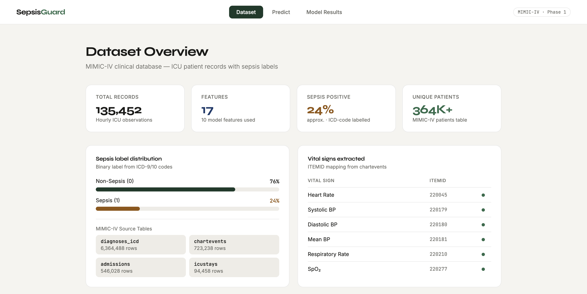
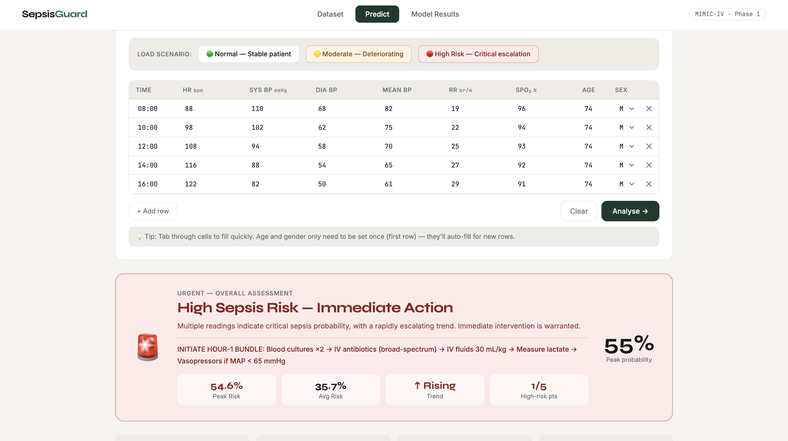
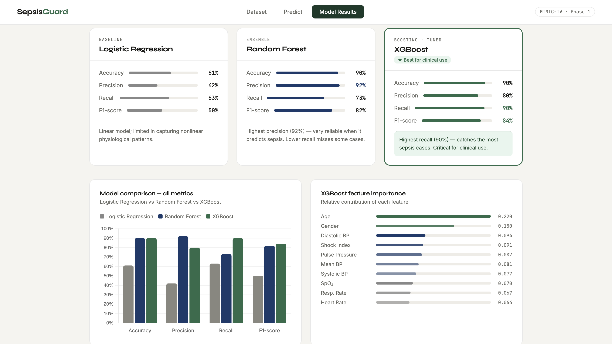

# 🧠 Personalized Disease Risk Prediction

A machine learning-based project for predicting sepsis risk using clinical data from the MIMIC-IV database. The project involves processing ICU patient records, extracting relevant clinical features, developing classification models, and evaluating their performance.

---

## 📌 Overview

Sepsis is a serious medical condition where early identification is important for timely medical intervention.

This project aims to develop a disease risk prediction system using patient information and clinical measurements obtained from the MIMIC-IV database.

The current implementation focuses on sepsis prediction using machine learning classification algorithms. SQL and Google BigQuery are used for data extraction, while Python is used for preprocessing, feature engineering and model development.

---

## 🖥️ Project Screenshots

### Dataset Overview

### Prediction Page

### Model Results

## 📊 Dataset

---

**MIMIC-IV Clinical Database**

The project uses clinical data extracted from multiple MIMIC-IV tables:

- `patients` – Patient demographic information.
- `admissions` – Hospital admission details.
- `icustays` – ICU stay information.
- `diagnoses_icd` – Diagnosis codes used for sepsis labeling.
- `chartevents` – Vital signs and clinical measurements recorded during ICU stays.

### Selected Clinical Parameters

The following seven vital signs were extracted using predefined ITEMIDs:

- Heart Rate
- Systolic Blood Pressure
- Diastolic Blood Pressure
- Mean Blood Pressure
- Respiratory Rate
- Oxygen Saturation (SpO₂)
- Temperature

Sepsis labels were generated using relevant ICD diagnosis codes.

The final processed dataset consists of **135,452 records with 17 features**.

*Note: MIMIC-IV is a credentialed-access research database. The original patient-level data is not included in this repository.*

---

## ⚙️ Data Processing and Preprocessing

SQL queries were executed using Google BigQuery to extract relevant information from the large clinical database.

The preprocessing pipeline includes:

- Extracting relevant clinical measurements using predefined ITEMIDs.
- Filtering records using patient, admission and ICU stay identifiers.
- Converting timestamps into datetime format.
- Aggregating vital sign measurements at hourly intervals.
- Removing missing and incomplete records.
- Handling missing values using forward-fill and backward-fill techniques.
- Encoding categorical variables into numerical format.
- Generating binary sepsis labels using ICD diagnosis codes.
- Integrating information from multiple tables into a unified dataset.

### Feature Engineering

Two additional clinical features were derived:

- **Shock Index:** Heart Rate / Systolic Blood Pressure
- **Pulse Pressure:** Systolic Blood Pressure − Diastolic Blood Pressure

These features were included to capture additional relationships between clinical measurements.

---

## 🤖 Machine Learning Models

Three classification algorithms were implemented and evaluated:

### 1. Logistic Regression

Implemented as the baseline classification model. StandardScaler was used for feature scaling, and class balancing was applied to address the imbalance between septic and non-septic records.

### 2. Random Forest

An ensemble learning algorithm used to capture nonlinear relationships between clinical measurements and patient demographics.

### 3. XGBoost

A gradient boosting algorithm further optimized through hyperparameter tuning. Parameters such as the number of estimators, learning rate, maximum tree depth, subsampling ratio and class balancing weights were adjusted to improve prediction performance.

---

## 📈 Model Evaluation

The models were evaluated using accuracy, precision, recall and F1-score.

| Metric | Logistic Regression | Random Forest | XGBoost |
|---|---:|---:|---:|
| Accuracy | 61% | 90% | 90% |
| Precision | 42% | 92% | 80% |
| Recall | 63% | 73% | 90% |
| F1-score | 50% | 82% | 84% |

The tuned XGBoost model achieved the highest recall and F1-score among the evaluated models.

Recall is particularly important in sepsis prediction because it measures the proportion of actual sepsis cases correctly identified by the model. A higher recall helps reduce false-negative predictions.

---

## 🖥️ Application and Implementation

The project includes a working prototype developed using Python and Flask.

The application follows a modular workflow:

1. **Data Ingestion:** Extracts clinical records from the MIMIC-IV database.
2. **Preprocessing:** Cleans and transforms clinical measurements into a structured format.
3. **Feature Engineering:** Generates additional clinical indicators.
4. **Model Training:** Trains and evaluates the classification models.
5. **Prediction:** Processes input health parameters and generates prediction results.

The current prototype is deployed locally using the Flask development server.

---

## 🛠️ Technologies Used

| Category | Technologies |
|---|---|
| Programming Language | Python |
| Database and Querying | SQL, Google BigQuery |
| Data Processing | Pandas, NumPy |
| Machine Learning | Scikit-learn, XGBoost |
| Data Visualization | Matplotlib, Seaborn |
| Web Framework | Flask |
| Development Environment | Jupyter Notebook, Google Colab |
| Version Control | Git, GitHub |

---

## 🚀 Future Scope

Future development will focus on extending the system through:

- Implementation of temporal deep learning models such as LSTM and GRU.
- Development of a more comprehensive web-based healthcare platform.
- Personalized health risk timeline visualization.
- AI-powered healthcare chatbot integration.
- Multi-disease risk prediction.
- Secure cloud deployment.
- Improved model interpretability.

